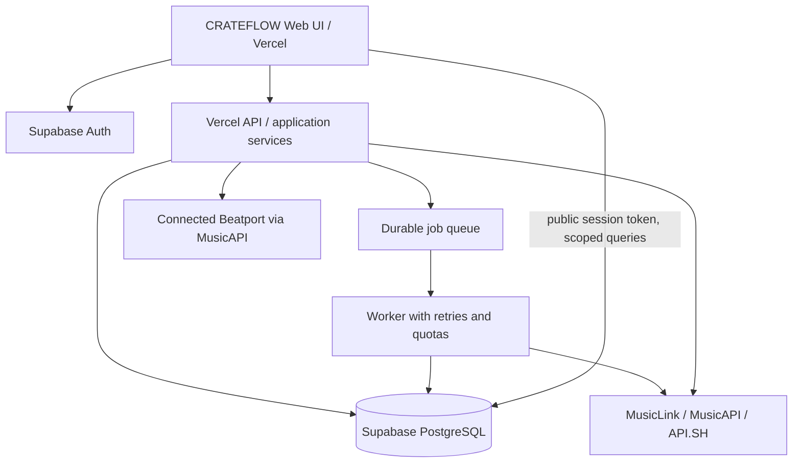

# CRATEFLOW 2.0 — Target architecture and current-state boundary

**Status:** Architecture proposal, not yet implemented. **Date:** 2026-11-20. Companion files: `PRODUCT_REQUIREMENTS.md`, `DATA_MODEL.md`, `MIGRATION_PLAN.md`, `SECURITY_OPERATIONS.md`, `ROADMAP.md`.

## 1. Architectural decision
Choose an **incrementally modularized monolith** with current Vercel hosting/Node API functions, Supabase PostgreSQL (cloud persistence), Supabase Auth (email + Google), RLS for tenant isolation, optional tightly controlled shared metadata cache, and a durable queue/worker later. Do not split into microservices without measured scale need. Preserve current UI and deployed workflow during migration.

### Why
- Current code is mostly static vanilla JavaScript, one large `app.js`, a browser-side state machine and Vercel serverless API functions.
- Current `localStorage` key is `crateflow_v1` (tracks, playlists, settings, syncHistory and other fields). No cross-device persistence.
- API.SH catalog lookup already serves title/artist/version/ISRC + BPM/Camelot/genre as primary source; connected MusicAPI search is fallback.
- Browser executes import/matching sequentially, up to 40 items then batches of 10, with provider rate/credit controls; not reliable unattended processing.
- Beatport playlist creation is an explicit action; lazy MusicAPI ID conversion and post-write read-back are essential safety controls.
- Production Vercel deployment must stay working while a separate preview/staging environment evolves.

## 2. Context diagram (logical)

**Security note:** Client-to-Supabase access is for carefully scoped RLS-protected user data; privileged operations and provider access go through authenticated server code. Diagram is target state.

## 3. Component boundaries
### Frontend
- UI: import, library, filters, playlists/folders, DJ sets/timeline, export, account.
- Client stores ephemeral UI preferences/state and a temporary migration backup, **not** the only copy of music data.
- Access to private data uses the authenticated session and strict user-scoped APIs/RLS.
- Do not trust browser-provided `user_id`, `price`, `subscription_tier`, `matched=true`, or export IDs as authoritative.

### Backend application services
- Identity/session verifier and ownership checks.
- Library CRUD, stable pagination, filtering, sort and concurrency policy.
- Playlist/folder CRUD, ordered placement, smart playlist rule validation.
- Metadata and matching orchestrator with provider adapter interfaces, identity validation and documented response normalization.
- Import/export jobs with quota accounting, retry, idempotency and error typing.
- External provider sessions and authorized Beatport writes.
- Billing/entitlements (when implemented): verified Stripe webhooks + internal subscription state.

### Database
- Private user-owned rows, folder and playlist relationships, durable jobs/history.
- Shared track metadata and identifiers **only where contractually permitted**; private fallback otherwise.
- RLS deny-by-default for user tables; limited service access and auditing for workers.
- Foreign keys, unique constraints, check constraints and pagination indexes; migrations in repository.

### Queue / worker
- Persist job before scheduling; reserve/lease items with visibility timeout.
- Bounded concurrency per provider/account, exponential backoff with jitter, poison-message/dead-letter policy.
- Exactly-once *effect* approximated by idempotency keys and DB state transitions; do not promise exactly-once execution.
- Pause/stop provider work on insufficient quota/cost budget; resume safely.
- Export writes require a deterministic idempotency/reconciliation strategy and may need manual recovery on uncertain provider response.

## 4. Data-flow contracts
### Import and matching
1. Parse input; validate canonical Spotify IDs, URLs, titles and artists.
2. Resolve Spotify original metadata; save source identity and ISRC if available.
3. Deduplicate **within user's own library**, without conflating remixes/releases.
4. Lookup permitted shared cache by verified identifiers. Do not make text-only cache results authoritative.
5. If cache misses/stale: API.SH primary provider, MusicAPI fallback when uncertain, rate/cost controlled.
6. Normalize provider candidates to `{provider, provider_track_id, title, artists[], mix, isrc, bpm, camelot, genre, verified_at}`.
7. Apply matching safeguards: title core, artist identities, explicitly requested mix, ISRC conflict, ambiguous releases. Store match provenance/evidence and version, not just percent.
8. Save confirmed track data; persist review-needed or error outcomes without inventing missing BPM/key/genre.

### Playlist/Beatport export
1. Only explicitly selected/qualified user-owned library tracks eligible.
2. Check linked Beatport account for **this** authenticated CRATEFLOW user.
3. Resolve/verify mapping from API.SH catalog ID to connected MusicAPI item ID; no cross-provider assumption.
4. Validate candidate versus original identity before any provider write. Stop or require review if any unresolved and user expects all-or-nothing selection.
5. Create private Beatport playlist, then append items, record remote playlist ID immediately.
6. Read back actual playlist. Distinguish verified member, missing, mismatched, unavailable, unverified availability and unverified read-back.
7. Persist partial failure and recovery path. Never equate in-playlist with purchased, downloadable or in-cart.
8. On retries, reconcile existing remote ID first; do not blindly create another playlist.

### Rekordbox export
Generate explicit XML only for tracks with meaningful local file paths/available file metadata. XML describes file locations but does not transfer audio. Validate XML structure, escaping and import compatibility against supported Rekordbox versions.

### DJ-set builder
Inputs: user playlist/tracks, BPM, key, optional duration and constraints. Outputs: **non-destructive, editable** ordered set, estimated timeline, rationale and missing-data warnings. BPM/key metadata is not audio fingerprinting and does not prove mix quality.

## 5. Cache strategy
- Store minimal permitted shared metadata; never cache entire raw provider response by default.
- Cache keys are namespaced (e.g. `spotify:track:...`, `beatport:catalog:...`, `musicapi:service_item:...`) with verification evidence and version.
- Prefer verified ISRC/ID associations; do not merge purely on same title/artist.
- TTL varies by field and provider licensing: stable identity may be longer, availability shorter; must be approved. Track `checked_at`, `expires_at`, `provider`, `license_scope`.
- `track_cache` may be referenced by `library_tracks` but loss/eviction must not delete a user's song.
- Prevent cache stampede with in-flight de-duplication and lease/lock when appropriate.
- No audio binaries, no confidential provider sessions or user membership list in shared cache.
- Plan selective cleanup for unused/expired entries after agreed retention, not uncontrolled full-catalog scraping.

## 6. Operational boundaries
- Current `npm start` serves static frontend only; Vercel API functions need deployment/runtime-specific testing.
- `npm test` runs `node --test tests/*.test.js`. `npm run build` copies static assets to `dist/`.
- Environments: local, Preview/Staging and Production with separate Supabase projects/keys. Migrations applied to staging first.
- Source-of-truth: Git main after reviewed PR; schema SQL version controlled.
- Protect current `crateflow_v1` and keep JSON backups before migration.
- No paid provider or production write tests without authorization and budget.

## 7. Decisions to validate during Codex audit
- Verify MusicAPI playlist API read-back shape and consistency, correct ID namespaces and whether direct catalog-ID export might safely be supported (do not assume).
- Verify API.SH response field shapes, licensing, credit billing and acceptable cache retention.
- Review existing code's matching and fallback edge cases, including cross-provider ambiguous mappings.
- Validate Rekordbox XML import requirements against actual supported version.
- Choose queue worker runtime and billing when costs/scale justify.
- Determine privacy region, retention, user deletion policy and payment/legal obligations.

## 8. Non-goals
Do not launch a scraped full Spotify/Beatport catalog, host copyrighted audio, implement unauthorized purchase/cart automation, build music-discovery recommendations, or prematurely split the monolith.
