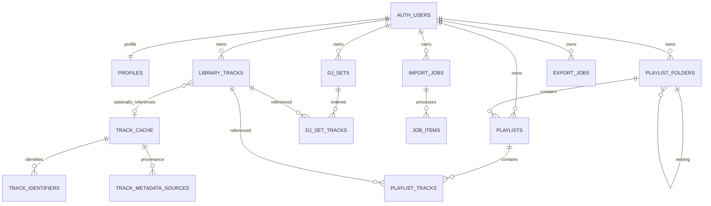

# CRATEFLOW 2.0 — Proposed relational data model

**Status:** Logical schema specification only. **Not a live migration.** Use the Codex audit to refine SQL, provider contracts, RLS policies, indexes, and constraints before creating any tables.

## 1. Invariants
- Every private entity has `user_id UUID NOT NULL`, referencing the authenticated user's `auth.users.id` or a user-owned parent with transitive owner checks.
- A `library_track` exists independently of a permitted shared metadata-cache record. User data must survive cache eviction and provider revocation.
- Source/original imported title/artist remain distinct from verified Beatport display title.
- A single musical recording may have multiple streaming or store releases; do not collapse version-specific identifiers into one unverified entity.
- Provider IDs are **namespaced**; `spotify_id`, `beatport_catalog_id`, `musicapi_item_id`, and `ISRC` are not interchangeable.
- External provider credentials and refresh tokens are encrypted/protected on the server, never in public queryable tables.
- Important state transitions are timestamped, traceable and idempotent.

## 2. Suggested initial tables

### Accounts (private)
- `profiles (user_id PK/FK auth.users, display_name, created_at, updated_at)`.
- `user_settings (user_id PK, settings JSONB of validated UI preferences, updated_at)` — minimally required system settings; no sprawling custom-user-fields feature.
- `provider_connections (id UUID PK, user_id, provider, external_account_ref, status, connected_at, expires_at, secret_ref)` — secret_ref points to isolated credential storage, not plaintext.
- `subscriptions (id UUID PK, user_id, stripe_customer_id UNIQUE NULL, stripe_subscription_id UNIQUE NULL, plan, status, current_period_end, updated_at)`. Stripe is a **proposed** later provider; no billing implementation exists now.

### Private library
- `library_tracks (id UUID PK, user_id, catalog_track_id NULL, original_title, original_artist, original_remix, display_title, display_artist, spotify_id NULL, isrc NULL, bpm NULL, camelot_key NULL, genre NULL, duration_ms NULL, source, ownership_status, match_status, beatport_catalog_id NULL, musicapi_item_id NULL, matched_at NULL, created_at, updated_at)`.
- `library_track_events (id UUID PK, user_id, library_track_id NULL, event_type, payload JSONB sanitized, created_at)` — import, selection, export and manual purchase/ownership status changes. Consider privacy retention and event limits.

### Conditional permitted shared cache (not essential for migration Phase 1)
- `track_cache (id UUID PK, canonical_title, canonical_artists JSONB, mix_version, isrc NULL, bpm NULL, camelot_key NULL, genre NULL, duration_ms NULL, source_provider, verified_at, expires_at, license_scope, metadata_version)`.
- `track_identifiers (id UUID PK, track_cache_id FK, provider, namespace, external_id, identifier_type, verification_status, evidence_ref NULL, verified_at NULL)` with unique `(provider, namespace, external_id)` **only for appropriately scoped identifiers**; do not assume all vendor IDs are globally unique.
- `track_metadata_sources (id UUID PK, track_cache_id FK, provider, attribute, verified_at, expires_at, source_version, allowed_cache_scope)`.

### Playlists, folders and sets (private)
- `playlist_folders (id UUID PK, user_id, parent_id NULL, name, position, created_at, updated_at)`. Prevent cycles via transactionally checked move or DB function, enforce same-user parent.
- `playlists (id UUID PK, user_id, folder_id NULL, name, kind ['manual','smart'], created_at, updated_at)`.
- `playlist_tracks (id UUID PK, user_id, playlist_id, library_track_id, position NUMERIC, added_at)`. Permit duplicate occurrences only if explicitly desired; otherwise unique `(playlist_id, library_track_id)`.
- `smart_playlist_rules (playlist_id PK/FK, user_id, rules JSONB validated server-side, updated_at)`. Query private library; never execute arbitrary SQL.
- `dj_sets (id UUID PK, user_id, source_playlist_id NULL, title, target_duration_ms NULL, created_at, updated_at)`.
- `dj_set_tracks (id UUID PK, user_id, dj_set_id, library_track_id, position, estimated_start_ms NULL, estimated_duration_ms NULL, created_at)`. A track can appear in multiple sets; never mutate original playlist order when generating a suggestion.

### Durable work and export history
- `import_jobs (id UUID PK, user_id, source_type, idempotency_key, status, total_count, processed_count, error_count, budget_snapshot JSONB, created_at, started_at, completed_at)`.
- `job_items (id UUID PK, user_id, job_id, original_source_ref, normalized_track_fingerprint, status, attempts, lease_until, provider_cost_units, result_library_track_id NULL, error_code NULL, updated_at)`.
- `export_jobs (id UUID PK, user_id, target_provider, source_playlist_id NULL, idempotency_key, provider_playlist_id NULL, status, requested_count, verified_count, outcomes JSONB sanitized, created_at, updated_at)`.

### Privacy lifecycle
- `account_deletion_requests (id UUID PK, user_id, requested_at, status, finalized_at NULL, notes_code NULL)` for authorized deletion workflow; ensure corresponding audit/retention rules.

This is a *logical* baseline of **19 tables**. Implementation may merge, split or defer certain tables with a documented ADR; do not create all tables prematurely.

## 3. Relationship map

## 4. Index and constraint recommendations
- `library_tracks(user_id, created_at DESC, id)`, `(user_id, ownership_status)`, `(user_id, camelot_key)`, `(user_id, bpm)` and full-text/trigram if justified by query workload.
- Partial unique `(user_id, spotify_id)` where spotify_id not null, but assess behavior for repeated versions and Spotify re-releases first.
- No blanket unique `(user_id, normalized_artist, normalized_title)`: different mixes/releases can share this text.
- `playlist_folders(user_id, parent_id, position)`, `playlist_tracks(playlist_id, position)`, `dj_set_tracks(dj_set_id, position)`.
- `job_items(job_id, status)`, `import_jobs(user_id, created_at DESC)`, `export_jobs(user_id, created_at DESC)`.
- Unique idempotency `(user_id, idempotency_key)` per job kind, plus CAS/status preconditions for retries.
- Check constraints: BPM range 40–240 when known; Camelot `1A..12B`, valid status enums/checks, positive duration, valid position.
- Folder parent and playlist_track references must belong to same user; foreign keys alone on UUIDs are not always sufficient; use composite keys or protected transactional functions.
- Use keyset pagination for large libraries and jobs.

## 5. RLS and grants — target invariants
- `profiles`, `library_tracks`, `playlists`, `playlist_folders`, `dj_sets`, job tables and histories: require `auth.uid() = user_id` for SELECT/INSERT/UPDATE/DELETE with appropriate USING/WITH CHECK.
- Add child ownership checks for playlist_tracks, set_tracks and smart rules; reject cross-tenant parent IDs even when the child user_id is self.
- `track_cache` and identifiers: treat as service-controlled; no unrestricted client-side writes. Public reads only if explicitly approved and contractually permitted.
- `provider_connections`, `subscriptions`, billing audit: limited visible fields to user; privileged updates only through verified server processes.
- Service-role credentials only server-side; RLS is not a substitute for verifying server operations.
- Tests must include malicious `user_id` spoof, cross-tenant folder/playlist references, stale auth, provider connection ID swapping, denied direct cache writes and deletion isolation.

## 6. Smart playlist rules
Suggested JSON DSL with validated whitelisted fields `genre`, `bpm_min`, `bpm_max`, `camelot_keys`, `ownership_status`, `artist_contains`; boolean grouping if needed later, depth-limited. Translate to parametrized queries with user_id predicate. Avoid arbitrary SQL expressions and unrestricted JSON-path execution.

## 7. Data volume and lifecycle
If N users each have L library entries, private linking rows scale O(N×L). Shared cache scales with distinct requested tracks, not provider catalog size. Metadata footprints are much smaller than audio binaries, but index/backup costs and license restrictions matter more than raw row text. Track `last_used_at` where justified; evict expired/unreferenced cache data according to approved policy. **Never** evict user library records due to shared-cache TTL.

## 8. Decisions / risks
- Track identity granularity: recording vs release/master. Document as an ADR before uniqueness constraints.
- Purchase history authenticity: user-declared vs externally confirmed provider purchase events.
- Provider licenses and what may be cached/shared, especially Spotify-derived data.
- How to migrate legacy duplicate/ambiguous entries without unsafe automatic merges.
- Availability of `duration_ms` for set timelines.
- Payment-provider retention vs deletion policy.
